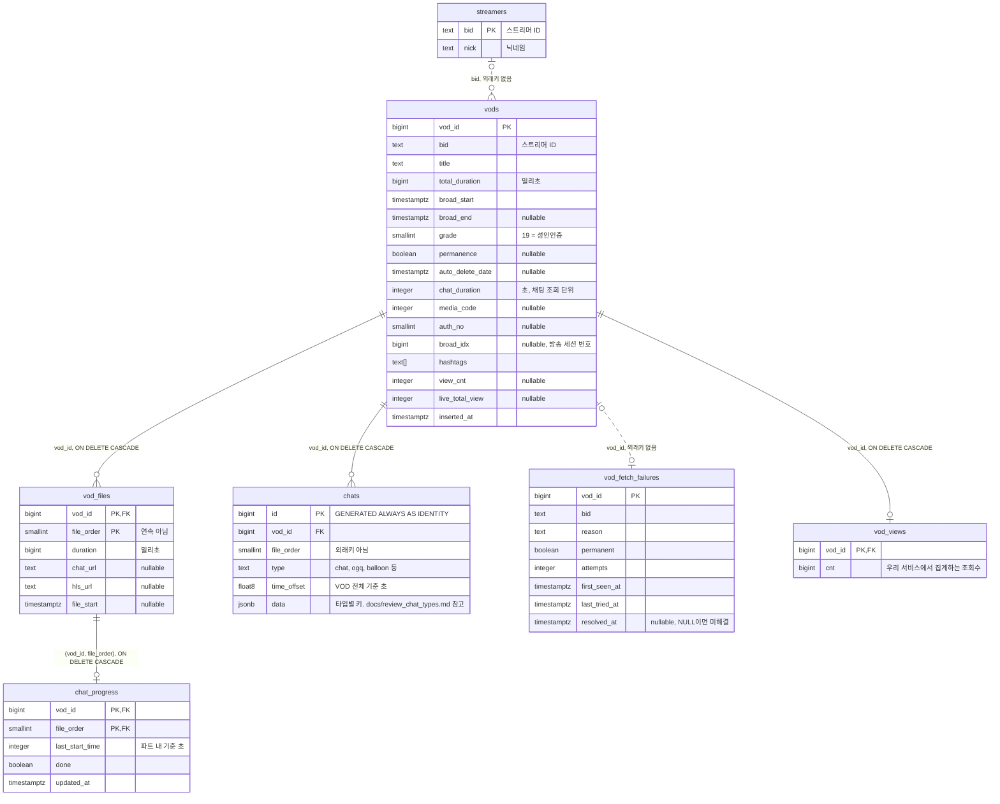

# ERD

테이블 정의의 주인은 ORM 모델(`app/models.py`)이고, DB에는 alembic 마이그레이션(`alembic/versions/`)으로 반영한다.
`sqls/schemas.sql`은 alembic을 쓰기 전의 초기 스키마라 지금 구조와 다르다(`chats.parts`, `streamers` 없음).

## 관계 설명

- **vods → vod_files**: VOD 하나에 파트 여러 개. `file_order`는 19금 파트 누락 등으로 연속이 아닐 수 있다.
- **vods → chats**: VOD 하나에 채팅 여러 개. `chats.file_order`는 구간 단위 재수집(DELETE 후 INSERT)에 쓰는 값이고, `vod_files`를 가리키는 외래키는 걸려 있지 않다.
- **vod_files → chat_progress**: 파트 하나에 진행 기록 최대 하나. 채팅 수집을 시작한 파트에만 행이 생긴다. 두 컬럼을 묶은 복합 외래키다.
- **streamers ↔ vods**: 같은 `bid`를 쓰지만 외래키가 없다(점선). `--bid`로 목록에 없는 스트리머를 수집하거나 목록에서 스트리머를 빼도 VOD는 남는다. API는 목록에 없는 bid의 VOD 상세에서 `nick` 자리에 bid를 넣는다.
- **vods → vod_views**: VOD 하나에 행 최대 하나. SOOP의 `view_cnt`와 달리 우리 서비스에서 센 조회수라 테이블을 나눴다.
- **vods ↔ vod_fetch_failures**: 같은 `vod_id`를 쓰지만 외래키가 없다(점선). 상세 조회에 실패한 VOD는 vods에 없을 수 있기 때문이다.

모든 외래키는 `ON DELETE CASCADE`라서 vods의 행을 지우면 파트, 진행 기록, 채팅, 조회수가 함께 지워진다.

## streamers

수집 대상 스트리머 목록이다. 두 수집기(review, live)가 시작할 때 읽고, API는 홈 목록과 bid 확인에 쓴다. 스트리머를 추가하거나 고치면 수집기를 다시 띄워야 반영된다.
목록 순서는 저장하지 않는다. DB의 정렬 규칙(`en_US.utf8`)으로는 한글이 가나다순으로 정렬되지 않아서, API가 파이썬에서 닉네임으로 정렬한다.