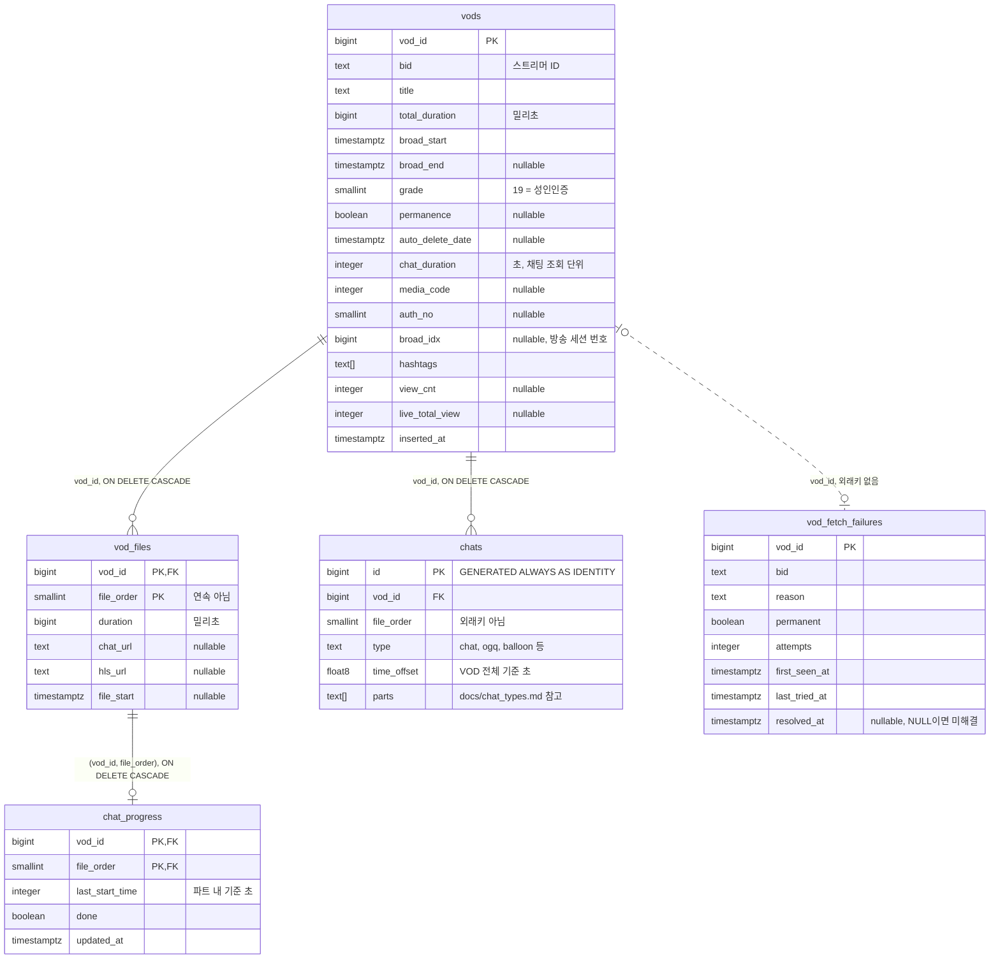

# ERD

테이블 정의의 주인은 `sqls/schemas.sql`이다. ORM 모델(`app/models.py`)은 같은 구조를 비춘다.

## 관계 설명

- **vods → vod_files**: VOD 하나에 파트 여러 개. `file_order`는 19금 파트 누락 등으로 연속이 아닐 수 있다.
- **vods → chats**: VOD 하나에 채팅 여러 개. `chats.file_order`는 구간 단위 재수집(DELETE 후 INSERT)에 쓰는 값이고, `vod_files`를 가리키는 외래키는 걸려 있지 않다.
- **vod_files → chat_progress**: 파트 하나에 진행 기록 최대 하나. 채팅 수집을 시작한 파트에만 행이 생긴다. 두 컬럼을 묶은 복합 외래키다.
- **vods ↔ vod_fetch_failures**: 같은 `vod_id`를 쓰지만 외래키가 없다(점선). 상세 조회에 실패한 VOD는 vods에 없을 수 있기 때문이다.

모든 외래키는 `ON DELETE CASCADE`라서 vods의 행을 지우면 파트, 진행 기록, 채팅이 함께 지워진다.